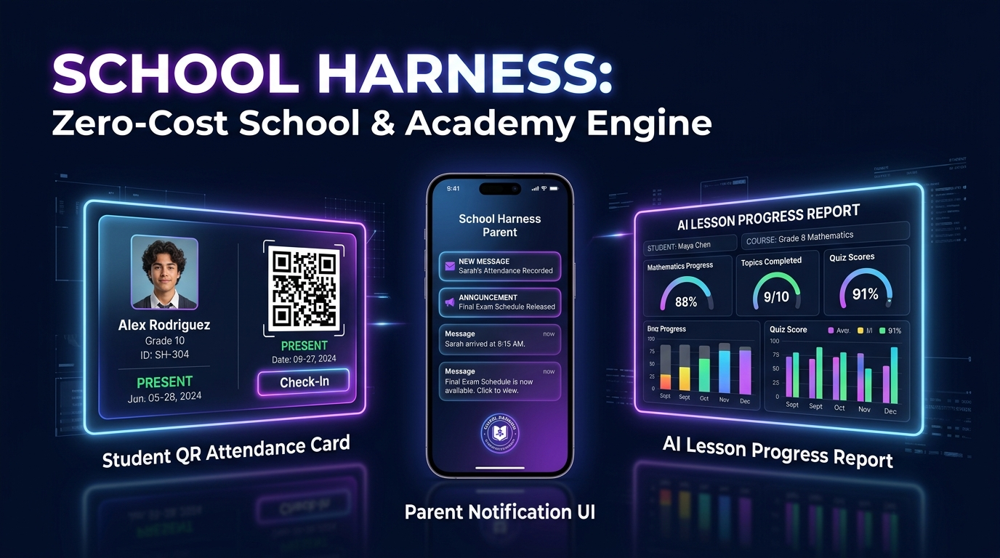

# School Harness 🎓📲
**Zero-Cost Academy Attendance, Parent LINE Notification & AI Lesson Report Engine on Cloudflare Workers + D1 + MCP**



Comiru（コミル）などの学習塾・習い事スクール管理SaaS（生徒数に応じた月額数万円の課金）を、**Cloudflare Workers + D1 の完全無料枠（月額0円）**で代替するオープンソースの入退室LINE通知＆AI指導レポート生成エンジンです。

## ✨ 主な特徴
1. **入退室リアルタイム保護者LINE通知**: 生徒のチェックインと同時に保護者のスマホへ安心の入室通知を即時配信。
2. **講師の負担をゼロにする「AI授業レポート自動下書き」**: その日の単元と小テスト点数を入れるだけで、保護者の満足度を高める丁寧な個別指導報告書をAIが自動生成。
3. **AIエージェント（MCP）完全対応**: Claude Code / Cursor から直接指導履歴を照会・分析可能。

## 🚀 クイックスタート
```bash
git clone https://github.com/reina20xx/school-harness.git
cd school-harness
npm install
npm run dev
node test-e2e.js
```
## 📄 ライセンス
MIT License
